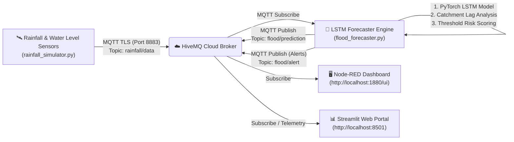

# 🌧️ Rainfall-Based Flood Early Warning System (FEWS)

An end-to-end IoT and Deep Learning Early Warning System designed to stream rainfall and river water level telemetry over **MQTT (HiveMQ Cloud)**, predict future water levels using a **Long Short-Term Memory (LSTM)** neural network, and trigger automated emergency early warnings displayed on **Node-RED** and **Streamlit** dashboards.

---

## 🏗️ System Architecture



---

## 🛠️ Tech Stack & Components

| Component | Technology | Purpose |
| :--- | :--- | :--- |
| **MQTT Broker** | HiveMQ Cloud (TLS Port 8883) | Secure cloud message broker streaming sensor packets and warning dispatches |
| **Backend & AI** | Python 3.13, PyTorch 2.15, Paho-MQTT | Real-time sequence processing, neural network inference, automated alert dispatch |
| **Forecasting Model** | PyTorch 2-layer LSTM ($R^2 = 99.73\%$) | Multi-step hydrological runoff forecasting using sliding windows of [rainfall, water level] |
| **IoT Dashboard** | Node-RED + `node-red-dashboard` | Real-time industrial IoT gauges, charts, risk banners, and audible toast popups |
| **Web Dashboard** | Streamlit + Plotly | Interactive operational portal with live hydrographs and "what-if" storm simulator |

---

## 📁 Project File Structure

- [`config.py`](config.py): HiveMQ Cloud credentials, MQTT topics, and flood threshold limits.
- [`lstm_model.py`](lstm_model.py): PyTorch `FloodLSTM` architecture and sequence normalization methods.
- [`train_lstm.py`](train_lstm.py): Synthetic hydrological catchment data generator & model training pipeline.
- [`flood_lstm_model.pth`](flood_lstm_model.pth): Trained neural network weights.
- [`scaler_params.json`](scaler_params.json): Mean/standard deviation parameters for real-time input scaling.
- [`rainfall_simulator.py`](rainfall_simulator.py): Sensor station streaming realistic storm cycles (`rainfall/data`).
- [`flood_forecaster.py`](flood_forecaster.py): Automated service that ingests telemetry, runs LSTM inference, evaluates risk, and publishes predictions (`flood/prediction`) & alerts (`flood/alert`).
- [`flow.json`](flow.json): Node-RED flow configuration with gauges, hydrographs, and alert popups.
- [`flood_dashboard.py`](flood_dashboard.py): Interactive Streamlit web interface.
- [`run_all.bat`](run_all.bat): One-click Windows batch launcher for all services.
- [`stop_all.bat`](stop_all.bat): One-click script to stop all services.

---

## 🎯 Water Level Thresholds & Automated Early Warning Rules

| Predicted Level ($h_{pred}$) | Severity State | UI Color | Automated Action Generated |
| :---: | :---: | :---: | :--- |
| **$< 1.50\text{ m}$** | **SAFE** | 🟢 Green | Normal baseline conditions. Routine hydrological monitoring. |
| **$1.50\text{ m} - 2.00\text{ m}$** | **WATCH** (Advisory) | 🟡 Yellow | Moderate rise detected. Alert drainage operators and monitor retention basins. |
| **$2.00\text{ m} - 2.50\text{ m}$** | **WARNING** | 🟠 Orange | High risk of riverbank breach. Open floodgates and mobilize sandbags. |
| **$> 2.50\text{ m}$** | **CRITICAL** | 🔴 Red | Extreme inundation imminent! Sound community sirens and trigger immediate evacuation. |

---

## 🚀 How to Run the System

### ⚡ Method 1: One-Click Launcher (Windows)
Double-click `run_all.bat` or run:
```cmd
run_all.bat
```

### 🖥️ Method 2: Manual Terminal Execution

#### 1️⃣ Step 1: Start the AI Forecaster Service
```powershell
python flood_forecaster.py
```

#### 2️⃣ Step 2: Start the Sensor Telemetry Streamer
```powershell
python rainfall_simulator.py
```

#### 3️⃣ Step 3: Launch Node-RED Dashboard
```powershell
node-red
```
1. Open your browser to **http://localhost:1880**.
2. Double-click the **HiveMQ Cloud** broker node and configure credentials under the **Security** tab if needed.
3. Open the visual dashboard at **http://localhost:1880/ui**.

#### 4️⃣ Step 4 (Optional): Launch Interactive Streamlit Web Portal
```powershell
streamlit run flood_dashboard.py
```
View the dashboard at **http://localhost:8501**.
